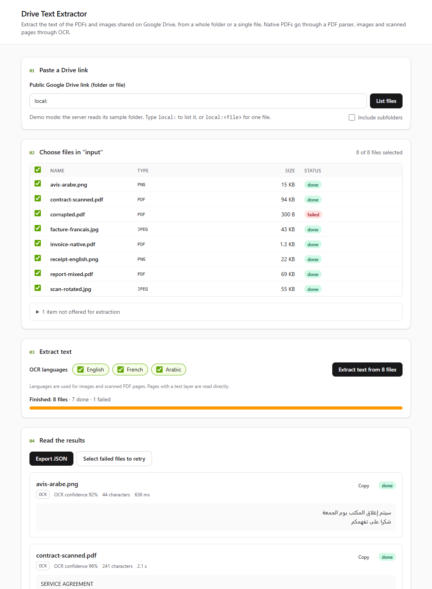
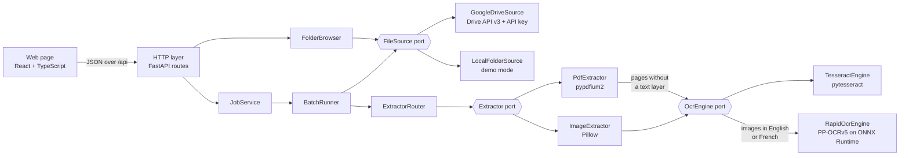

# Drive Text Extractor

[](https://github.com/hae-emna/drive-text-extractor/actions/workflows/ci.yml)
[](LICENSE)

Paste a public Google Drive link (a whole folder or a single file), pick the PDFs and images,
and get their text back. Each file goes through the right pipeline: a **PDF parser** for native PDFs, **OCR**
for images and for scanned PDF pages. Photos and screenshots are read by a deep-learning OCR engine that
finds text anywhere in the picture. Results can be read per file and exported as JSON.



## Contents

- [What it does](#what-it-does)
- [Quick start](#quick-start)
- [Local development](#local-development)
- [Architecture](#architecture)
- [Technical choices](#technical-choices)
- [API and JSON output](#api-and-json-output)
- [Configuration](#configuration)
- [Quality](#quality)
- [Known limits](#known-limits)
- [Next steps](#next-steps)
- [Licence](#licence)

## What it does

| Step | In the app |
|---|---|
| 01 Paste a public Drive link | Accepts folder links and single-file links in every common format (`/drive/folders/…`, `/file/d/…/view`, `open?id=`, `uc?id=`, download links). Invalid and private links, and Google Docs links, get a specific message. |
| 02 List the documents | Shows PDFs, PNG and JPEG files with name, type and size, optionally from subfolders. Everything else is listed as *skipped*, with a reason. A single-file link lists that file and selects it. |
| 03 Select files | Per-file checkboxes, **Select all** (with a partial state); the selection count stays visible. |
| 04 Run the batch | One job for the selection. Each file shows `pending`, `processing`, `done` or `failed`, live; a failing file never stops the others. The job can be cancelled. |
| 05 Read the results | Text per file with the method used (`PDF parser`, `OCR`, or both for mixed PDFs), OCR confidence with a warning when low, and **Export JSON**. |

All five bonus items are covered:

- **Scanned PDFs detected and OCR'd automatically.** The decision is made per page, so a typed document with a scanned annex is handled correctly.
- **Asynchronous processing with live progress.** Background jobs with bounded concurrency; the page polls every second.
- **Docker one-command setup.** `docker compose up --build`.
- **Automated tests.** 283 backend tests (unit, contract, API, real Tesseract and RapidOCR) and 84 frontend tests, plus an end-to-end smoke test of the Docker image in CI.
- **OCR language selection.** English, French and Arabic, combinable; Arabic text is displayed right-to-left.

## Quick start

You need Docker. The app runs on <http://localhost:8000>.

### With Google Drive

1. Get a Google Cloud API key (free, about 5 minutes):
   1. In the [Google Cloud console](https://console.cloud.google.com/), create a project.
   2. *APIs & Services → Library*: enable the **Google Drive API**.
   3. *APIs & Services → Credentials → Create credentials → API key*.
   4. Edit the key and, under *API restrictions*, restrict it to the Google Drive API.
2. Configure and start:
   ```bash
   cp .env.example .env          # then set GOOGLE_API_KEY=... in .env
   docker compose up --build
   ```
3. Paste the link of a Drive folder or file shared as **"Anyone with the link"**. A public test
   folder holding the files of [`samples/input`](samples/input) is ready to use (tick *Include
   subfolders* to get the one in a subfolder):
   <https://drive.google.com/drive/folders/1HvFp6xojrjdTFNgeMda4QNCwMCHfKVef>

   [`samples/output-drive.json`](samples/output-drive.json) is its export with English and French
   selected, and [`samples/output-drive-arabic.json`](samples/output-drive-arabic.json) the Arabic
   notice read with Arabic selected.

No OAuth is involved: only public folders and files are in scope, so an API key is enough.

### Without an API key (demo mode)

```bash
FILE_SOURCE=local docker compose up --build      # PowerShell: $env:FILE_SOURCE="local"; docker compose up --build
```

Type `local:` as the link (or `local:report-mixed.pdf` for a single file). The server reads
[`samples/input`](samples/input), a folder in which each file exercises one path of the pipeline
(see [its README](samples/README.md)).

## Local development

Requirements: Python 3.13 with [uv](https://docs.astral.sh/uv/), Node.js 24, and Tesseract with
the French and Arabic language packs:

| OS | Install Tesseract |
|---|---|
| Debian / Ubuntu | `sudo apt install tesseract-ocr tesseract-ocr-fra tesseract-ocr-ara` |
| macOS | `brew install tesseract tesseract-lang` |
| Windows | [UB Mannheim installer](https://github.com/UB-Mannheim/tesseract/wiki): tick French and Arabic, add the install folder to `PATH` |

```bash
# Backend: http://localhost:8000/api, interactive docs at /docs
cd backend
uv sync
uv run uvicorn drive_text_extractor.main:create_app --factory --reload

# Frontend: http://localhost:5173, proxies /api to the backend
cd frontend
npm ci
npm run dev
```

Checks run by CI:

```bash
cd backend  && uv run ruff check && uv run ruff format --check && uv run mypy && uv run pytest
cd frontend && npm run lint && npm run format:check && npm run typecheck && npm test && npm run build
docker build --target test -t dte-test . && docker run --rm dte-test    # backend suite with real Tesseract
```

RapidOCR's models (about 14 MB) are downloaded on first use, into the installed package or into
`OCR_MODELS_DIR` if set; the Docker image has them built in. Tests that need Tesseract are marked
`ocr` and skipped when it is not installed. Git hooks
(ruff, hygiene checks, Conventional Commits on messages): `pre-commit install`.

## Architecture



The backend is organised around three small ports (`domain/ports.py`). Services depend only on
them; concrete classes are chosen in a single composition root, `main.create_app`.

```
backend/src/drive_text_extractor/
├── domain/        models, job lifecycle, error taxonomy, ports. Imports nothing else from the package
├── drive/         GoogleDriveSource: link parsing, listing, download, retries
├── local/         LocalFolderSource: the same port over a server folder (demo mode)
├── extractors/    PdfExtractor, ImageExtractor, text normalisation
├── ocr/           TesseractEngine, RapidOcrEngine, engine choice by language, line layout, image preparation
├── services/      ExtractorRouter, FolderBrowser, BatchRunner, JobService, InMemoryJobStore
├── api/           routes, request/response schemas, error envelope
├── config.py      every setting, read once from the environment
├── container.py   the wired services handed to the HTTP layer
└── main.py        composition root
frontend/src/
├── api/           typed client and types mirroring the backend schemas
├── features/      folder (link, table, selection), batch (languages, run, progress), results
├── components/    Button, Alert, Section, Spinner
└── lib/           formatting and error helpers
```

How SOLID shows up, without frameworks or abstract factories:

- **Single responsibility.** Each class has one job: the Drive client only lists and downloads, the router only chooses an extractor, the runner only orchestrates a batch, and routes only translate HTTP.
- **Open/closed.** An extractor declares the media types it handles and recognises its own content. A new format is a new class plus one line in `main.py`; `test_router_extension.py` proves it with a WebP extractor.
- **Liskov.** `test_contract.py` runs the same suite against every extractor: same result shape, non-overlapping detection, only `ExtractionError` on bad input.
- **Interface segregation.** Three small protocols (`FileSource`, `Extractor`, `OcrEngine`) rather than one service interface.
- **Dependency inversion.** Services receive ports. `LocalFolderSource` was added without touching any service, and single-file links only changed the two sources. Tests swap in fakes with no network and no OCR binary.

What happens to one file in a batch:

1. **Download.** The size is refused up front when declared, and capped while streaming.
2. **Route on content, not on the declared type.** `%PDF-` goes to the PDF extractor; PNG and JPEG signatures go to the image extractor; anything else is `unsupported_file`.
3. **PDFs, page by page.** A page with at least `PDF_OCR_MIN_CHARS` visible characters in its text layer is parsed. Otherwise it is rendered in grayscale at 300 DPI and OCR'd.
4. **Images.** EXIF orientation is applied, transparency flattened onto white, the image converted to grayscale with contrast stretched, and small images upscaled. Tesseract's orientation detection straightens sideways scans. Then, when every selected language is English or French, **RapidOCR** reads the image: a text detector finds each line wherever it is (a sign, a caption, a timestamp), each line is read on its own, and the lines are put back in reading order, with a blank line between pieces of text that are far apart. With Arabic selected, Tesseract reads the image, as it does every scanned PDF page.
5. **Record the outcome.** Text is normalised (NFKC, so the Arabic presentation forms found in PDFs become regular letters). Expected failures keep their error code; anything unexpected is logged and recorded as `internal_error`.

## Technical choices

| Area | Choice | Why | Rejected |
|---|---|---|---|
| Backend | Python 3.13 + **FastAPI** | The PDF and OCR ecosystem is Python-first. FastAPI is async (Drive I/O, background jobs), typed end to end with Pydantic, and generates OpenAPI docs | Node.js: weaker PDF and OCR libraries |
| PDF parser | **pypdfium2** (Apache-2.0 / BSD-3) | PDFium (Chrome's engine) is robust on real-world files. One library both reads the text layer and renders pages for OCR | PyMuPDF (AGPL-3.0), pdf2image + Poppler (GPL), pdfplumber (redundant) |
| OCR, pages | **Tesseract 5** via pytesseract (Apache-2.0) | Open source, self-hostable, ships French and Arabic models, gives per-word confidence, and its layout analysis suits pages: scanned PDF pages, Arabic images, orientation detection | Cloud OCR (paid, not self-hosted) |
| OCR, photos and screenshots | **RapidOCR** (Apache-2.0): PaddleOCR's PP-OCRv5 models on ONNX Runtime (MIT) | Tesseract segments a page into blocks before reading; on a photo or a screenshot it finds almost nothing (on a café screenshot: `21:09 4 all > GD`, at 83% confidence). A text detector finds every line wherever it is: the same screenshot gives `modern circle`, `Café and concept store`, `Spend the`, `with us`, `Modern Circle · a year ago`, `0:01 0:09`, at 96%. It also keeps the French accents Tesseract drops. About 1 s per image on a CPU | EasyOCR (PyTorch, far heavier); PaddleOCR itself (PaddlePaddle runtime); tuning Tesseract (sparse-text mode and upscaling recovered two of the lines, with more noise) |
| Image preparation | **Pillow** | EXIF rotation, transparency, contrast and upscaling cover common failures; orientation comes from Tesseract itself | OpenCV for preprocessing (installed now as a RapidOCR dependency, but Pillow already does the job) |
| Google Drive | **Drive API v3 + API key**, over httpx | Official, stable, returns name, type and size; no OAuth needed for public folders. The key stays on the server, in a header | Scraping Drive's web pages (fragile, against the terms of service) |
| Async work | In-process background tasks + **polling** | The simplest thing that gives live per-file progress; parsing and OCR run in a thread pool with bounded concurrency | Celery / Redis (a production step, not POC scope); SSE (polling is enough at 1 s) |
| Frontend | **React + TypeScript**, Vite, Tailwind | The page holds real state (selection, live statuses, results, errors), and typed components plus pure helpers keep it testable. It is also DI Xpertia's own stack | Plain JavaScript: harder to keep correct as the UI grew |
| Packaging | **Docker** multi-stage, docker compose | Tesseract is a system binary, so Docker is the honest way to get "runs in one command". The RapidOCR models are fetched at build time, so the container needs no network to read images. One origin serves the API and the page | |
| Tooling | uv, ruff, mypy (strict), pytest; oxlint, Prettier, Vitest; pre-commit; GitHub Actions | Locked dependencies, the same checks locally and in CI, Conventional Commits enforced by a hook | |

Licences of every dependency, and the alternatives rejected for licence reasons:
[LICENSES.md](LICENSES.md).

## API and JSON output

| Method | Path | Purpose |
|---|---|---|
| GET | `/api/health` | Version, source type, OCR languages and whether each pack is installed |
| POST | `/api/files/list` | `{link, recursive}` → `kind` (`folder` or `file`), the supported files, and skipped files with reasons |
| POST | `/api/jobs` | `{link, file_ids, languages, recursive}` → `202` and a job snapshot |
| GET | `/api/jobs/{id}` | Per-file status, method, per-page text, confidence, error |
| POST | `/api/jobs/{id}/cancel` | Skip the files that have not started yet |
| GET | `/api/jobs/{id}/export` | Versioned JSON export, downloaded as a file |

Errors always have the same shape, `{"error": {"code": "folder_not_found", "message": "..."}}`,
with codes such as `invalid_link`, `folder_not_found`, `file_not_accessible`, `rate_limited`, `file_too_large`,
`corrupt_file`, `encrypted_file` and `ocr_timeout`. The server re-lists the folder before
starting a job, so only files that really belong to it can be processed.

One file from [`samples/output-drive.json`](samples/output-drive.json), a PDF with a typed page and
a scanned page:

```json
{
  "file": { "id": "1hgJLkDpKQkakPj2BzJDCqT18BO2O4DJd", "name": "report-mixed.pdf", "path": "report-mixed.pdf",
            "mime_type": "application/pdf", "size_bytes": 69376, "modified_time": "..." },
  "status": "done",
  "method": "mixed",
  "mean_confidence": 95.4,
  "low_confidence": false,
  "char_count": 179,
  "duration_ms": 5060,
  "text": "Quarterly report Q3 2026\nTyped summary page with a text layer.\n\nANNEX A - Service levels\n...",
  "pages": [
    { "number": 1, "method": "pdf_parser", "confidence": null, "text": "Quarterly report Q3 2026\n..." },
    { "number": 2, "method": "ocr", "confidence": 95.4, "text": "ANNEX A - Service levels\n..." }
  ],
  "error": null
}
```

The export wraps the files with `schema_version` (currently `1.1`), `job_id`, timestamps,
`languages`, the `source` (type, `kind` of link, link, folder or file) and a `summary` of counts
per status. Additive changes bump the minor version.

## Configuration

All settings are environment variables, documented in [`.env.example`](.env.example). Only
`GOOGLE_API_KEY` is needed in Drive mode; there are no other secrets.

| Variable | Default | Meaning |
|---|---|---|
| `GOOGLE_API_KEY` | | Google Cloud API key with the Drive API enabled |
| `FILE_SOURCE` | `google_drive` | `local` for the demo mode |
| `LOCAL_FOLDER` | `../samples/input` | Root folder of the demo mode |
| `MAX_FILE_SIZE_MB` | `25` | Larger files are refused |
| `MAX_LISTED_FILES` | `1000` | Listing stops here and is flagged as truncated |
| `MAX_PDF_PAGES` | `200` | Longer PDFs are refused |
| `PDF_OCR_MIN_CHARS` | `20` | Pages with fewer visible characters in their text layer are OCR'd |
| `PDF_RENDER_DPI` | `300` | Resolution of scanned pages sent to OCR |
| `MAX_IMAGE_MEGAPIXELS` | `50` | Decompression-bomb guard, checked before decoding |
| `OCR_TIMEOUT_SECONDS` | `120` | Per image or page |
| `OCR_AUTO_ROTATE` | `true` | Orientation detection before OCR |
| `IMAGE_OCR_ENGINE` | `rapidocr` | `tesseract` to read images with Tesseract only |
| `OCR_MODELS_DIR` | | Folder for RapidOCR's models; unset, they live in the installed package. Docker sets `/opt/ocr-models` |
| `BATCH_CONCURRENCY` | `2` | Files processed at the same time |
| `LOW_CONFIDENCE_THRESHOLD` | `60` | Below this mean OCR confidence, output is flagged |
| `LOG_LEVEL` | `INFO` | |

## Quality

- **Tests.**
  - Backend: 283, including contract tests for extractors, a fake Drive API served through `httpx.MockTransport`, API tests through the real routes, real-Tesseract tests (rotation at 90/180/270°, a scanned PDF) and real-RapidOCR tests (scattered captions on a dark picture, French accents, a sideways page).
  - Frontend: 84, including component tests and the full flow against a fake backend.
  - Docker: the CI job starts the built image in demo mode and runs [`scripts/smoke_test.py`](scripts/smoke_test.py).
- **Bugs found by the tests, kept as regression tests.**
  - PDFium is not thread-safe; parallel extraction crashed the process with a segfault in CI (#16).
  - Tesseract reports orientation clockwise while Pillow rotates counter-clockwise (#12).
  - Upscaling images already at scan resolution degraded OCR (#28).
  - uv's download cache was left in the Docker image; it went unnoticed until the OCR dependencies made it 390 MB.
- **Security.**
  - The API key travels in a header, never in a URL, and never reaches the browser.
  - The server never fetches the user's link: it builds Drive URLs from an id matching `[A-Za-z0-9_-]{10,}`.
  - Downloads are capped while streaming, pixel counts are checked before decoding, PDF pages and OCR time are bounded.
  - Demo-mode paths cannot escape their root.
  - `.env` is excluded from Git and from the Docker build context, and the container runs as a non-root user.
- **Git.** One issue per feature, a branch and a pull request per issue, merge commits into `main`, Conventional Commits enforced by a commit-msg hook, and every pull request merged only after its CI checks passed.

## Known limits

- **Arabic OCR is the weakest path.** Tesseract's Arabic line detection is unreliable: depending on font and size it can skip whole lines while still reporting high confidence on the lines it reads. The sample `avis-arabe.png` loses its title line. The confidence flag does not catch missing lines.
- **Accents.** Tesseract sometimes loses French accents (`à` → `a`). RapidOCR keeps them, but it only reads images; scanned PDF pages still go through Tesseract.
- **Arabic switches images back to Tesseract.** RapidOCR's Arabic model needs a right-to-left dependency (`python-bidi`, LGPL) that was not added, so selecting Arabic sends images to Tesseract, with its weaker results on photos.
- **Confidence measures what was found, not what was missed.** It is the engine's certainty about the text it read; text it did not detect at all does not lower it. The page says so next to the score.
- **Jobs live in memory.** They are lost on restart, the app runs as a single process, and finished jobs are evicted after 100.
- **No authentication or rate limiting.** Anyone who can reach the server can use its Drive API quota.
- **Polling, not push.** Each poll returns the whole job, texts included, which is fine for tens of files but wasteful for hundreds.
- **Cancel only skips files that have not started.** A file already in OCR runs to the end (bounded by `OCR_TIMEOUT_SECONDS`).
- **Text only.** No table structure or layout; reading order on multi-column pages is PDFium's or Tesseract's.
- **Scanned-page detection is a character threshold.** A page with both a real text layer and a picture of more text keeps only the text layer.
- **Not supported yet.**
  - Google Docs, Sheets and Slides are skipped instead of exported to PDF.
  - Folder shortcuts are not followed.
- **OCR quality depends on the picture.** Handwriting and decorative script fonts are mostly missed (on the café screenshot, the script "Spend the day" comes out as `Spend the`), and icons are sometimes read as letters (`X`, `II`).
- **Image size.** The Docker image is about 1 GB. Most of the growth from RapidOCR comes from OpenCV (with video codecs it never uses here), ONNX Runtime and NumPy; the models themselves are 14 MB.

## Next steps

Towards production, roughly in order of value:

1. **Queue and storage.** Move jobs to Redis (or a database) with separate workers (RQ / Celery) so processing scales and survives restarts. `InMemoryJobStore` and `BatchRunner` are already separated for this.
2. **Better Arabic OCR, and RapidOCR for scanned pages.** Build a small labelled evaluation set, then compare Tesseract's `tessdata_best` models with RapidOCR's Arabic model (and its `python-bidi` dependency), and RapidOCR with Tesseract on scanned PDF pages, behind the `OcrEngine` port.
3. **Result cache** keyed by file id + modified time + languages + pipeline version, so re-runs are instant.
4. **Push progress.** Use server-sent events or a WebSocket instead of polling, sending only changed files.
5. **Authentication and per-user quotas**, structured logs and metrics (per-file duration, OCR confidence distribution).
6. **More inputs.** Export Google Workspace files to PDF through the Drive API; add other image formats (WebP, TIFF) as new extractors.
7. **Layout-aware extraction** (tables, reading order) where documents need it.
8. **Contract generation.** Generate the TypeScript types from the OpenAPI schema instead of mirroring them by hand.

## Licence

[MIT](LICENSE) © 2026 Emna Najai. Third-party licences: [LICENSES.md](LICENSES.md).

Portions of this software are copyright © The FreeType Project (www.freetype.org). All rights
reserved. (FreeType is bundled inside the Pillow and pypdfium2 wheels.)
