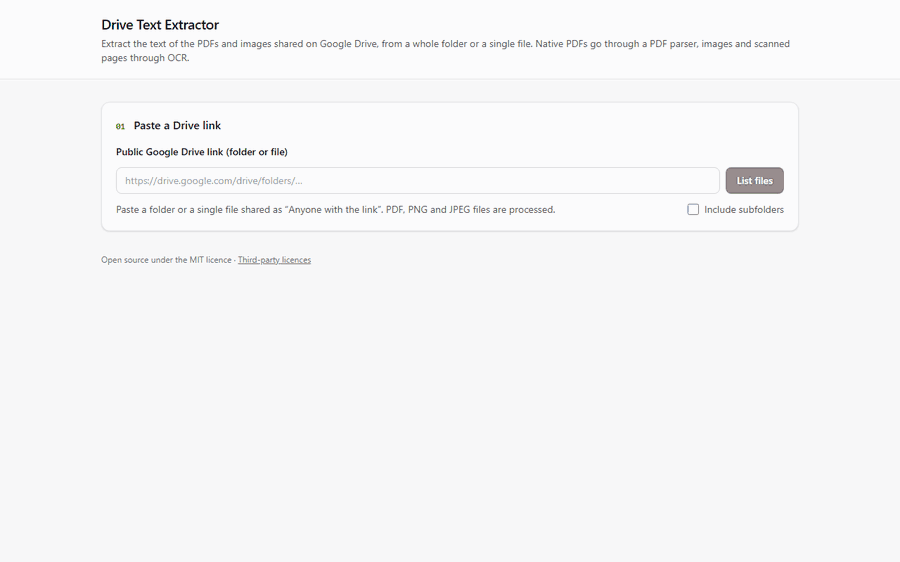
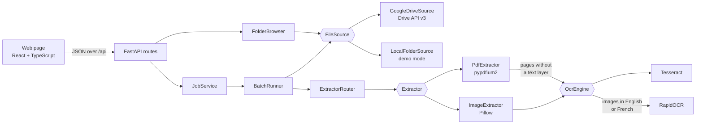

# Drive Text Extractor

[](https://github.com/hae-emna/drive-text-extractor/actions/workflows/ci.yml)
[](LICENSE)

Paste a public Google Drive link (a folder or a single file), pick the PDFs and images, and get
their text back. Each file goes through the right pipeline: a **PDF parser** for native PDFs,
**OCR** for images and scanned PDF pages. Results are shown per file and exported as JSON.



- [What it does](#what-it-does) · [Quick start](#quick-start) · [Local development](#local-development)
- [Architecture](#architecture) · [Technical choices](#technical-choices) · [API and JSON output](#api-and-json-output)
- [Quality](#quality) · [Known limits](#known-limits) · [Next steps](#next-steps) · [Licence](#licence)

## What it does

| Step | In the app |
|---|---|
| 01 Paste a link | Folder and single-file links in every common Drive format. Invalid links, private files and Google Docs get a specific message. |
| 02 List | PDFs, PNG and JPEG files with name, type and size, optionally from subfolders. Anything else is listed as skipped, with the reason. |
| 03 Select | Per-file checkboxes and **Select all**; the selection count stays visible. |
| 04 Run the batch | One job for the selection. Each file shows `pending`, `processing`, `done` or `failed` live; a failing file never stops the others. The job can be cancelled. |
| 05 Read the results | Text per file with the method used (`pdf_parser`, `ocr`, or `mixed` for a PDF with scanned pages), OCR confidence with a warning when low, and **Export JSON**. |

All five bonus items are covered: scanned PDFs are detected **page by page** and OCR'd;
processing is asynchronous with live progress; `docker compose up --build` runs everything; the
routing and extraction logic is covered by automated tests; OCR languages (English, French,
Arabic) can be combined, and Arabic is displayed right-to-left.

## Quick start

You need Docker. The app runs on <http://localhost:8000>.

1. Get a Google Cloud API key (free, about 5 minutes): in the
   [Google Cloud console](https://console.cloud.google.com/), create a project, enable the
   **Google Drive API** (*APIs & Services → Library*), then *Credentials → Create credentials →
   API key*, and restrict the key to the Drive API.
2. Configure and start:
   ```bash
   cp .env.example .env          # then set GOOGLE_API_KEY=... in .env
   docker compose up --build
   ```
3. Paste the link of a folder or file shared as **"Anyone with the link"**. This public test
   folder holds the files of [`samples/input`](samples/input) (tick *Include subfolders*):
   <https://drive.google.com/drive/folders/1HvFp6xojrjdTFNgeMda4QNCwMCHfKVef>

   [`samples/output-drive.json`](samples/output-drive.json) is its export with English and French
   selected, and [`samples/output-drive-arabic.json`](samples/output-drive-arabic.json) the Arabic
   notice read with Arabic selected.

No OAuth is involved: only public links are in scope, so an API key is enough.

**Without an API key**, run the demo mode, which reads [`samples/input`](samples/input) from the
server instead of Drive, and type `local:` as the link:

```bash
FILE_SOURCE=local docker compose up --build      # PowerShell: $env:FILE_SOURCE="local"; docker compose up --build
```

Every setting is an environment variable documented in [`.env.example`](.env.example) (limits,
OCR options, concurrency). `GOOGLE_API_KEY` is the only secret.

## Local development

Requirements: Python 3.13 with [uv](https://docs.astral.sh/uv/), Node.js 24, and Tesseract with
the French and Arabic packs (`apt install tesseract-ocr tesseract-ocr-fra tesseract-ocr-ara`,
`brew install tesseract tesseract-lang`, or the
[UB Mannheim installer](https://github.com/UB-Mannheim/tesseract/wiki) on Windows).

```bash
# Terminal 1 - backend on http://localhost:8000/api, interactive docs at /docs
cd backend
uv sync
uv run uvicorn drive_text_extractor.main:create_app --factory --reload
```

```bash
# Terminal 2 - frontend on http://localhost:5173, proxies /api to the backend
cd frontend
npm ci
npm run dev
```

The checks CI runs, from the repository root:

```bash
(cd backend && uv run ruff check && uv run ruff format --check && uv run mypy && uv run pytest)
(cd frontend && npm run lint && npm run format:check && npm run typecheck && npm test && npm run build)
docker build --target test -t dte-test . && docker run --rm dte-test   # backend tests with real Tesseract
```

Tests that need Tesseract are skipped when it is not installed. Git hooks (ruff, hygiene,
Conventional Commits): `uvx pre-commit install`.

## Architecture



How SOLID shows up, without frameworks or abstract factories:

- **Single responsibility.** The Drive client only lists and downloads, the router only picks an
  extractor, the runner only runs a batch, and the routes only translate HTTP.
- **Open/closed.** An extractor declares the types it handles, so a new format is a new class plus
  one line in `main.py`; `test_router_extension.py` adds a WebP extractor that way. RapidOCR came
  in as a second OCR engine without changing any extractor or service (#46).
- **Liskov substitution.** `test_contract.py` runs one suite against every extractor: same result
  shape, no overlapping detection, only `ExtractionError` on bad input.
- **Interface segregation.** Three small protocols in `domain/ports.py` (`FileSource`,
  `Extractor`, `OcrEngine`) rather than one service interface.
- **Dependency inversion.** Whatever touches the outside world (Drive, the file system, OCR
  engines) is reached through those protocols and wired in one place, `main.create_app`. The demo
  mode was added without touching a service, and tests run with fakes, without network or OCR
  binaries. `JobService` takes the other services as concrete classes: there is one of each, and
  a job-store protocol only pays off with a second store (see *Next steps*).

```
backend/src/drive_text_extractor/
├── domain/       models, job lifecycle, error codes, ports (imports nothing else from the package)
├── drive/        GoogleDriveSource: link parsing, listing, download, retries
├── local/        LocalFolderSource: the demo mode
├── extractors/   PdfExtractor, ImageExtractor, text normalisation
├── ocr/          Tesseract and RapidOCR engines, engine choice, image preparation
├── services/     ExtractorRouter, FolderBrowser, BatchRunner, JobService, job store
├── api/          routes, schemas, error envelope
├── config.py     settings, read once from the environment
└── main.py       composition root
frontend/src/
├── api/          typed client
├── features/     folder (link, table, selection), batch (languages, progress), results
├── components/   shared UI pieces
└── lib/          formatting, pagination, errors
```

What happens to one file in a batch:

1. **Download**, refused up front when the declared size is too large and capped while streaming.
2. **Route on content**, not on the declared type: `%PDF-` goes to the PDF extractor, PNG and
   JPEG signatures to the image extractor, anything else fails as `unsupported_file`.
3. **PDFs, page by page.** A page with at least `PDF_OCR_MIN_CHARS` visible characters in its
   text layer is parsed; otherwise it is rendered at 300 DPI and OCR'd.
4. **Images.** EXIF rotation, transparency, contrast and upscaling are fixed with Pillow, and
   Tesseract's orientation detection straightens sideways scans. RapidOCR then reads the image
   when every selected language is English or French; with Arabic, Tesseract does.
5. **Record the outcome.** Text is normalised (NFKC); expected failures keep their error code,
   anything else is logged and recorded as `internal_error`.

## Technical choices

| Area | Choice | Why | Rejected |
|---|---|---|---|
| Backend | Python 3.13, **FastAPI** | The PDF and OCR ecosystem is Python-first; FastAPI is async for Drive I/O, typed with Pydantic, and documents itself (OpenAPI) | Node.js: weaker PDF and OCR libraries |
| PDF | **pypdfium2** (Apache-2.0 / BSD-3) | PDFium is robust on real files, and one library both reads the text layer and renders pages for OCR | PyMuPDF (AGPL-3.0), pdf2image + Poppler (GPL) |
| OCR, pages | **Tesseract 5** (Apache-2.0) | Self-hosted, French and Arabic models, per-word confidence, orientation detection; its page layout analysis suits scans | Paid cloud OCR |
| OCR, photos | **RapidOCR** (Apache-2.0): PP-OCRv5 models on ONNX Runtime | Tesseract finds little text in photos and screenshots (on a café screenshot: `21:09 4 all > GD`); a text detector found six lines of it at 96%, and keeps French accents. About 1 s per image on a CPU | EasyOCR (PyTorch, much heavier) |
| Drive | **Drive API v3 + API key**, httpx | Official and stable, returns name, type and size; no OAuth for public links. The key stays on the server | Scraping Drive's pages (fragile, against the terms of service) |
| Async | Background tasks in the process + **polling** | The simplest way to get live per-file progress; extraction runs in a thread pool with bounded concurrency | Celery/Redis (a production step) |
| Frontend | **React + TypeScript**, Vite, Tailwind | The page holds real state (selection, live statuses, results); typed components and pure helpers keep it testable | Plain JavaScript |
| Packaging | **Docker** multi-stage, compose | Tesseract is a system binary, so Docker is the honest "one command"; one origin serves the API and the page | |

Licences of every dependency, and the alternatives rejected for licence reasons:
[LICENSES.md](LICENSES.md).

## API and JSON output

| Method | Path | Purpose |
|---|---|---|
| GET | `/api/health` | Source type, OCR languages and whether each pack is installed |
| POST | `/api/files/list` | `{link, recursive}` → supported files, and skipped items with a reason |
| POST | `/api/jobs` | `{link, file_ids, languages, recursive}` → `202` and a job snapshot |
| GET | `/api/jobs/{id}` | Per-file status, method, text per page, confidence, error |
| POST | `/api/jobs/{id}/cancel` | Skip the files that have not started |
| GET | `/api/jobs/{id}/export` | Versioned JSON export |

Errors share one shape, `{"error": {"code": "...", "message": "..."}}`, with codes such as
`invalid_link`, `folder_not_found`, `file_not_accessible`, `rate_limited`, `file_too_large`,
`corrupt_file` and `ocr_timeout`. The server lists the folder again before a job starts, so only
files that belong to it are processed.

One file of [`samples/output-drive.json`](samples/output-drive.json), a typed page followed by a
scanned annex:

```json
{
  "file": { "name": "report-mixed.pdf", "mime_type": "application/pdf", "size_bytes": 69376, "...": "..." },
  "status": "done",
  "method": "mixed",
  "mean_confidence": 95.4,
  "low_confidence": false,
  "text": "Quarterly report Q3 2026\nTyped summary page with a text layer.\n\nANNEX A - Service levels\n...",
  "pages": [
    { "number": 1, "method": "pdf_parser", "confidence": null, "text": "Quarterly report Q3 2026\n..." },
    { "number": 2, "method": "ocr", "confidence": 95.4, "text": "ANNEX A - Service levels\n..." }
  ],
  "error": null
}
```

The export wraps the files with `schema_version`, `job_id`, timestamps, `languages`, the
`source` and a `summary` of counts per status.

## Quality

- **Tests:** 284 backend (extractor contract tests, a fake Drive API over `httpx.MockTransport`,
  API tests through the real routes, real Tesseract and RapidOCR runs) and 87 frontend
  (components and the full flow against a fake backend). CI also builds the Docker image and runs
  [`scripts/smoke_test.py`](scripts/smoke_test.py) against it.
- **Bugs found this way, kept as regression tests:** PDFium is not thread-safe and crashed the
  process under parallel extraction (#16); Tesseract reports orientation clockwise while Pillow
  rotates counter-clockwise (#12); upscaling images already at scan resolution degraded OCR
  (#28).
- **Security:** the API key travels in a header and never reaches the browser; the server never
  fetches the user's URL, it builds Drive URLs from a validated id; downloads, image pixels and
  PDF pages are capped; the container runs as a non-root user; `.env` stays out of Git and of
  the Docker build context.
- **Git:** one issue, branch and pull request per change, Conventional Commits enforced by a
  hook, and each pull request merged after CI passed.

## Known limits

- **Arabic OCR is the weakest path.** Tesseract can skip whole Arabic lines while still reporting
  high confidence on the lines it reads (`avis-arabe.png` loses its title). Selecting Arabic also
  sends images to Tesseract, as RapidOCR's Arabic model needs an LGPL dependency.
- **Confidence measures what was read, not what was missed.** The page says so next to the score.
- **Jobs live in memory**, in a single process: lost on restart, and finished jobs are evicted after 100.
- **No authentication or rate limiting** on the app itself: anyone who can reach it uses its
  Drive quota.
- **Only Tesseract has a time limit** (`OCR_TIMEOUT_SECONDS`); a RapidOCR image runs to the end,
  and cancelling only skips files that have not started.
- **Text only:** no tables or layout. A page counts as scanned below a character threshold, so a
  page with a real text layer and a picture of more text keeps only the text layer.
- **Not supported:** Google Docs, Sheets and Slides (skipped), folder shortcuts.
- **The Docker image is about 1 GB**, mostly OpenCV, ONNX Runtime and NumPy for RapidOCR.

## Next steps

1. **Queue and storage:** jobs in Redis or a database with separate workers, so processing scales
   and survives restarts.
2. **Better Arabic OCR:** a small labelled set to compare Tesseract's `tessdata_best` with
   RapidOCR's Arabic model, behind the `OcrEngine` port.
3. **Result cache** keyed by file id, modified time, languages and pipeline version.
4. **Push progress** with server-sent events instead of polling the whole job.
5. **Authentication and quotas**, structured logs and metrics.
6. **More inputs:** export Google Workspace files to PDF; layout-aware extraction for tables.

## Licence

[MIT](LICENSE) © 2026 Emna Najai. Third-party licences: [LICENSES.md](LICENSES.md).

Portions of this software are copyright © The FreeType Project (www.freetype.org). All rights
reserved. (FreeType is bundled inside the Pillow and pypdfium2 wheels.)
